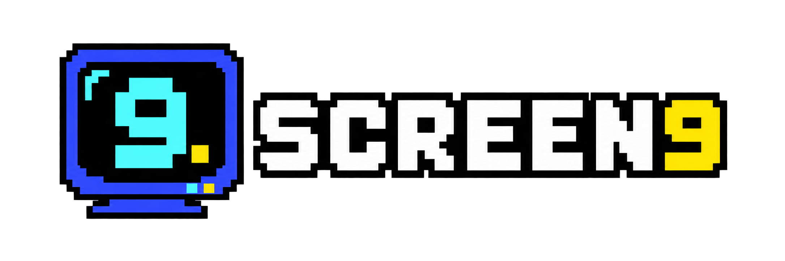
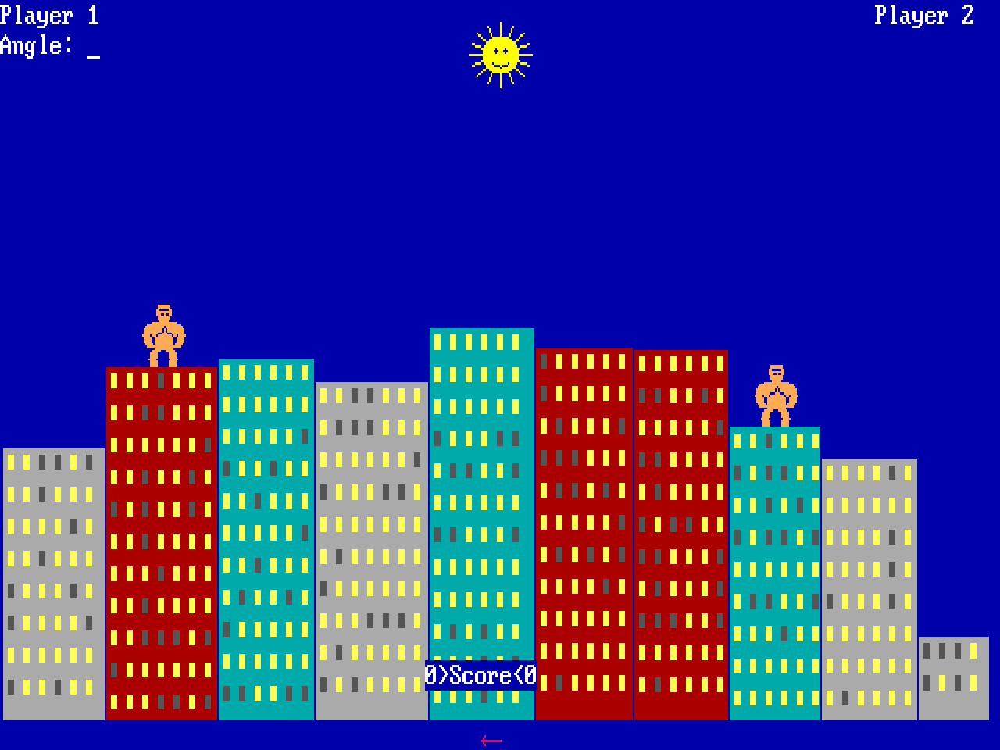
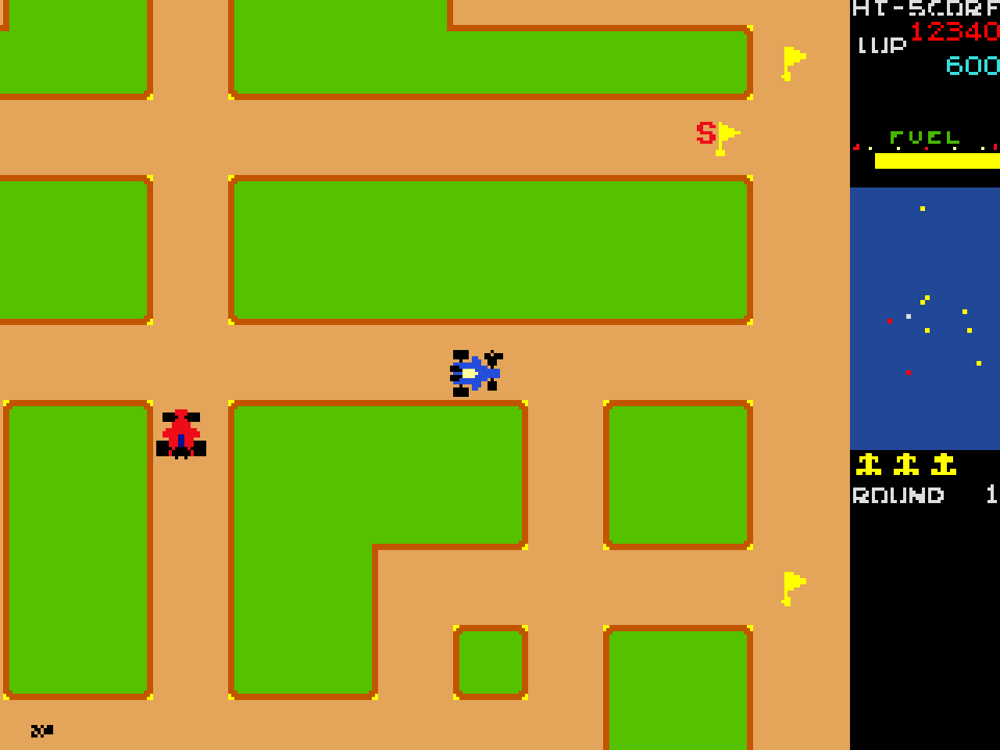
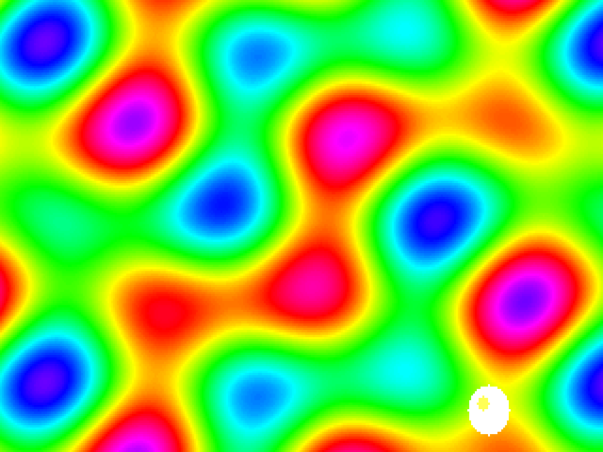

<p align="center">
  
</p>

# Screen9

A .NET engine for games with a retro flavour but a modern build, born from QBasic and its `SCREEN 9`.
Its emblem is Gorilla: the same game written in C#, in QBasic and in Python, on the same engine.

Read the [story](HISTORY.md) and the [roadmap](ROADMAP.md), browse the [documentation](DOCUMENTATION.md), or jump to the [quick start](USAGE.md). Comments and bugs: [GitHub Issues](https://github.com/marcoparenzan/Screen9/issues).

<p align="center">
  
  
  
</p>

## The parts

| Part | Projects | What it does |
|---|---|---|
| **Engine** | `src/Screen9`, `src/Screen9.Tests` | An indexed CGA/EGA/VGA machine (`PCCanvas`), IBM ROM fonts, video ports and memory, a double-buffered Windows renderer and an ANSI truecolor one. Used directly from C#. |
| **QBSharp** | `src/QBSharp.*` | The language: a QBasic interpreter and the modern qbs dialect, CLI and editor (`qbs`), standard library, AI. Built on the engine; it can run whole games or script a C# game. |
| **Python** | `src/Screen9.Python`, `samples/python` | The `screen9` package for PySharp (a Python interpreter in .NET): a wheel containing `Screen9.dll`, installed with `pysharp install`. |
| **Web** | `src/Screen9.Web` | The same engine and the same QBSharp (interpreter and editor) in a Blazor site (Server, with the games running in the browser as WebAssembly): Gorillas in C#, Gorillas `.bas`, Rally-X, a TUI editor and a Monaco editor with Ralf. See [docs/web](docs/web/README.md). |

The single solution is [Screen9.slnx](Screen9.slnx), with the folders `engine`, `qbsharp`, `samples` and `web`.
QBSharp uses the engine as a project reference: no intermediate packages.

## Samples

```text
samples/
  csharp/Gorilla/     Gorillas in C# (file-based app, only Gorillas.cs on top of the engine)
  csharp/RallyX/      Rally-X in C# (mode 12, 16 colours): a second game on the engine, also on the site (/rally-x)
  csharp/Demos/       engine demos: cell scene, VGA plasma, smoke test on a real Console (also on the site)
  qbsharp/Gorilla/    the original GORILLA.BAS (Microsoft 1990), run by qbs
  qbsharp/*.bas       language samples and tests
  csharp/Gorilla/gorillas.csx   Gorillas as a C# script (ops/csx.cs, or Monaco / the web page)
  python/Gorilla/     Gorillas in Python (pysharp run gorillas.py, with the screen9 package)
```

```powershell
dotnet run samples/csharp/Gorilla/Gorillas.cs
dotnet run ops/build-python-wheel.cs; pysharp install screen9 --find-links ops/artifacts/python
pysharp run samples/python/Gorilla/gorillas.py
dotnet run ops/csx.cs -- samples/csharp/Gorilla/gorillas.csx      # Gorillas as a C# script (Roslyn)
dotnet run -c Release samples/csharp/RallyX/RallyX.cs             # Rally-X (arrows/WASD, space = smoke); --demo plays by itself
dotnet run --project src/QBSharp.Cli -- run samples/qbsharp/Gorilla/GORILLA.BAS --dialect qbasic
dotnet run --project samples/csharp/Demos
dotnet run --project src/Screen9.Web   # the engine and QBSharp in a site: see docs/web
```

For a quick start covering the whole repository see [USAGE.md](USAGE.md).

## Build and test

```powershell
dotnet build Screen9.slnx
dotnet test Screen9.slnx
```

Run the QBSharp tests from PowerShell or cmd: under Git Bash some terminal tests depend on the environment.

## Documents

- Engine: [docs/engine](docs/engine/README.md) (formerly ConsoleLib).
- QBSharp: [docs/qbsharp](docs/qbsharp/README.md).
- Web: [docs/web](docs/web/README.md).
- Everything, indexed: [DOCUMENTATION.md](DOCUMENTATION.md); the story: [HISTORY.md](HISTORY.md); where it is going: [ROADMAP.md](ROADMAP.md).
- Screenshots of the games and demos, ready to reuse, are in [docs/images](docs/images) (`dotnet run ops/make-screenshots.cs` renders them again).

The device subsystem (pixel window, raster text, `PLAY` and speaker, keyboard, `GET`/`PUT` sprites) lives in the engine: QBSharp and the C# Gorilla use the same types (`PixelWindow`, `PCTextDisplay`, `PCMusic`/`PCSpeaker`, `PCKeyboard`, `PCSprite`), and the Python Gorilla imports them from PySharp's `screen9` package.
